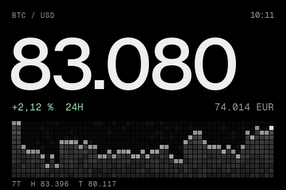
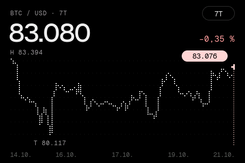
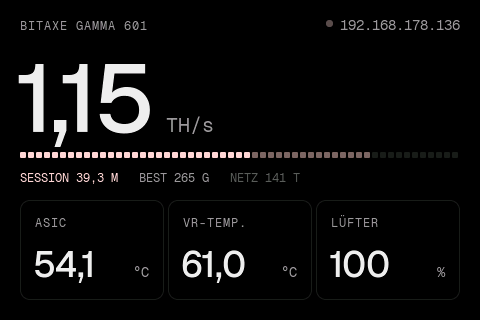
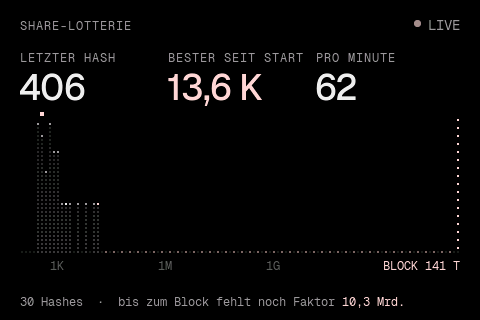

# Satoshi Deck

**Website:** https://mailmichaellehmann-crypto.github.io/bitaxe-deck/

Bitcoin- und Solo-Mining-Dashboard für das 3,5"-Touch-Display **WT32-SC01 Plus** (ESP32-S3)
und den **Bitaxe Gamma 601**. Gestaltung im Stil von Strike: schwarz, Geist-Schrift, Punktmatrix,
Akzent Pink `#FFD4D4`.

<p>
 
 
</p>

- 13 Karten, endlos per Wischen oder Tippen an den Rand: Preis, USD/EUR, Chart, Block, **Neuer Block** (Blockkette mit Animation: ein Pixel-Block fällt in die Kette, die Blockhöhe rollt hoch), **Halving** (Vollbild aus Pixel-Sand), Gebühren, Difficulty, Uhr, **Wetter** (aktuell und 5 Tage, Open-Meteo), Bitaxe, **Mining-Kosten** (Verbrauch, Kosten pro Tag/Monat/Jahr, Stromzähler), **Share-Lotterie** (jeder Hash des Bitaxe live); jede einzeln abschaltbar
- Einstellungen per langem Druck, Kartenmenü, Preisalarm, Nachtmodus in wählbarer Farbe (Bernstein, Tiefrot, Kerzenlicht, Rosé, Phosphor, Eisblau), automatischer Seitenwechsel
- Einrichtung über eigenes WLAN mit QR-Code, Einstellungen im Browser
- **OTA-Updates** direkt aus den GitHub-Releases dieses Repositorys

Details zur Firmware: [firmware/README.md](firmware/README.md)

## Installation

1. Unter **Releases** die Datei `bitaxe_deck_full.bin` herunterladen.
2. Display per USB-C anschließen und flashen (Python mit `pip install esptool`):

   ```bash
   python -m esptool --chip esp32s3 write_flash 0x0 bitaxe_deck_full.bin
   ```

3. Das Display öffnet ein Setup-WLAN mit QR-Code – Handy verbinden, WLAN und Bitaxe-IP eintragen.

## Updates (OTA)

Das Display prüft alle 6 Stunden das neueste Release dieses Repositorys. Gibt es eine neuere
Version, lädt es `bitaxe_deck.bin` über HTTPS und startet neu – automatisch, sobald 5 Minuten
niemand das Display berührt hat, oder sofort per Knopf (Einstellungen am Gerät oder im Browser).
Startet die neue Firmware nicht sauber mit WLAN, springt das Display beim nächsten Start
automatisch auf die vorherige Version zurück.

**Neue Version veröffentlichen:**

```bash
git tag v1.5.0
git push origin v1.5.0
```

GitHub Actions baut dann die Firmware ([.github/workflows/firmware.yml](.github/workflows/firmware.yml))
und hängt `bitaxe_deck.bin` (für OTA) und `bitaxe_deck_full.bin` (für die Erstinstallation) an das Release.

## Selbst bauen

```bash
cd firmware
. ~/esp/esp-idf/export.sh     # ESP-IDF 5.3
idf.py build
idf.py -p /dev/cu.usbmodem1101 flash monitor
```

## Browser-Dashboard (erste Version)

Die ursprüngliche Web-Variante läuft auf dem Rechner (`server.js`, `public/`) und zeigt die Daten im
Browser an. Sie ist unabhängig von der Firmware.

### Voraussetzungen

- Node.js 18 oder neuer (es werden **keine** npm-Pakete gebraucht)
- Internetzugang für die Markt- und Netzwerkdaten
- Der Bitaxe im selben lokalen Netz

> **Hinweis zu deinem Mac:** Die Homebrew-Node-Version 25 startet bei dir gerade nicht (es fehlt `libsimdjson`).
> Entweder du nutzt Node 24 direkt (siehe unten) oder du reparierst Node 25 mit `brew reinstall node`.

### Starten

1. Im Terminal in diesen Ordner wechseln.
2. Den Server starten:

   ```bash
   /opt/homebrew/opt/node@24/bin/node server.js
   ```

   (Wenn `node -v` bei dir funktioniert, reicht auch `npm start`.)
3. Im Browser **http://127.0.0.1:8420** öffnen.
4. Oben rechts auf das Zahnrad ⚙ (oder „IP eintragen“) klicken, die IP deines Bitaxe eintragen, z. B. `192.168.1.42`, auf **Verbindung testen** und dann auf **Speichern** klicken.

Die IP findest du im AxeOS-Webinterface, auf dem Display des Bitaxe oder in deinem Router (Gerätename meist `bitaxe`). Hostnamen wie `bitaxe.local` gehen auch.

Beenden mit `Ctrl + C` im Terminal.

#### Optionen

| Variable    | Bedeutung                                       | Standard    |
|-------------|-------------------------------------------------|-------------|
| `PORT`      | Port des Dashboards                             | `8420`      |
| `HOST`      | Adresse, an die der Server bindet               | `127.0.0.1` |
| `BITAXE_IP` | Bitaxe-Adresse, wenn im Browser noch keine eingetragen ist | –  |

Beispiel:

```bash
BITAXE_IP=192.168.1.42 /opt/homebrew/opt/node@24/bin/node server.js
```

Willst du das Dashboard vom Handy im WLAN öffnen, starte mit `HOST=0.0.0.0` und öffne `http://<IP-deines-Macs>:8420`.
Dann kann es jeder im WLAN aufrufen; der Proxy fragt aber nur Geräte mit privater IP ab.

### Ohne Gerät testen

Ein simulierter Bitaxe liegt bei:

```bash
/opt/homebrew/opt/node@24/bin/node tools/mock-bitaxe.js
```

Danach im Dashboard als Adresse `127.0.0.1:8081` eintragen.

### Wie es funktioniert

- `server.js` liefert die Seite aus und ist gleichzeitig ein kleiner **Proxy**:
  - `/bitaxe/system/info?host=<IP>` → `http://<IP>/api/system/info`. Der Umweg ist nötig, weil der Browser wegen CORS nicht direkt auf AxeOS zugreifen darf. Der Proxy fragt nur private Adressen im LAN ab (10.x, 172.16–31.x, 192.168.x, 127.x).
  - `/ext/coingecko/…` und `/ext/mempool/…` holen die öffentlichen APIs ohne API-Key und speichern sie kurz zwischen (60 s / 20 s), damit die Rate-Limits nicht greifen.
- `public/` enthält das Frontend (HTML, CSS, JavaScript, Chart.js über cdnjs).
- IP, Intervall, Strompreis und der Messverlauf (bis 24 h, alle 15 s ein Punkt) liegen im `localStorage` des Browsers. „Verlauf löschen“ in den Einstellungen leert ihn.

### Die Rechnungen

- **Solo-Chance:** Pro Sekunde findet der Miner einen Block mit der Rate λ = Hashrate / (Difficulty · 2³²). Die Chance in der Zeit t ist 1 − e^(−λ·t).
- **Erwartungswert:** λ · 86 400 · (Block-Subsidy + Ø Gebühren der letzten Blöcke)
- **Effizienz:** Leistung (W) ÷ Hashrate (TH/s) = J/TH
- **„Ticketpreis“:** So viel Strom pro Jahr bräuchte man für 1 % Jahreschance auf einen Block, bei der Effizienz deines Bitaxe.

